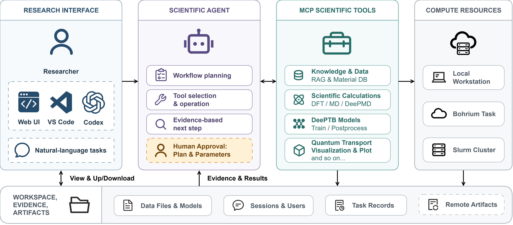

<div align="center">
  
  <h1>DeePTB Pilot</h1>
  <p><strong>面向 DeePTB 与计算材料科学工作流的智能科研助手</strong></p>
  <p>用自然语言连接知识检索、结构处理、电子结构、分子动力学、量子输运、远程计算与结果可视化。</p>
</div>

---

## 项目简介

DeePTB Pilot 是一个围绕 [DeePTB](https://github.com/deepmodeling/DeePTB) 构建的全栈科研智能体系统，将大语言模型、领域知识库、Model Context Protocol（MCP）、可组合科研工具、任务审批机制以及本地/远程执行环境整合在同一套工作流中。

用户可以通过 Web、VS Code 或 Codex，以自然语言完成从“查资料、找结构、准备输入”到“运行计算、检查参数、分析结果、下载产物”的完整闭环。当前仓库覆盖 DeePTB、ABACUS、LAMMPS、DeePMD-kit、DP-NEGF 等多个计算环节，并提供 Materials Project、COD、C2DB 和 DeePTB 本地知识库检索能力。

## 系统架构



系统由研究界面、科学 Agent、MCP 科研工具和计算资源四层组成。Web UI、VS Code 扩展和 Codex 插件共享 FastAPI/WebSocket 后端；Agent 负责任务规划、工具选择、知识检索和人工确认；会话、运行记录、计算文件及远程产物由后端统一管理。

## 适用场景

- 学习 DeePTB 的理论、配置、代码实现与典型工作流；
- 从材料数据库搜索和下载晶体结构；
- 生成 DeePTB-E3 训练配置、构造 DeePTB-SK 基准模型，并使用 dftio 数据训练 SK/E3 模型；
- 预测能带、DOS/PDOS、哈密顿量并分析带隙；
- 运行或组织 ABACUS、LAMMPS、DeePMD-kit 与 DP-NEGF 任务；
- 构建应变扫描、压管、结构弛豫和量子输运工作流；
- 将计算任务从本地切换到 Bohrium 或 Slurm 环境；
- 批量提交具有依赖关系的科研任务、绘制对比图并追踪计算产物；
- 在浏览器、VS Code 或 Codex 中管理会话、文件、参数和计算结果。

## 核心特点

- **面向科研任务的 Agent**：系统提示、知识库和工具均围绕 DeePTB 与计算材料科学设计。
- **知识与执行统一**：同一个会话既能检索论文、教程、源码和文档，也能直接调用计算工具生成真实文件与结果。
- **多步任务先规划后执行**：复杂请求会生成结构化工作流，列明步骤、依赖、输入、输出、风险和待确认问题。
- **Pilot Review 科学复核**：用户可在执行前要求 Agent 从科学逻辑、执行逻辑、阻塞问题、风险和建议等维度复核计划。
- **人在回路中的参数确认**：指定工具执行前会暂停，用户可使用表单或 JSON 检查并修改模型生成的参数。
- **会话级执行环境绑定**：本地、Bohrium 和 Slurm 配置绑定到当前会话，远程执行器不会依赖模型在对话中手工拼接。
- **按聊天隔离运行与排队**：每个 chat 使用独立 Agent 上下文、运行锁和 FIFO 队列，跨聊天可并发执行。
- **带依赖的批量任务调度**：支持有向无环图（DAG）、读写资源冲突检查、并发限制及失败后继续独立任务或停止后续任务的策略。
- **可组合的 MCP 科研工具层**：不同工具以结构化输入输出衔接，能够组合成训练、预测、弛豫和输运流水线。
- **多客户端共享同一后端**：Web UI、VS Code 扩展和 Codex 插件复用相同的 FastAPI 会话与文件协议。
- **科研结果原位可视化**：支持晶体结构、布里渊区、图片、曲线和表格等结果在交互界面中直接展示。
- **会话、文件和产物闭环**：每个用户会话拥有独立工作区，可上传、预览、下载、删除和复用计算文件。

## 仓库结构

| 路径 | 作用 |
| --- | --- |
| `dptb_pilot/core/` | Agent、会话辅助、Guardrail、任务图调度、产物登记、日志与 Photon 计费 |
| `dptb_pilot/server/` | FastAPI、REST/WebSocket、chat 运行时、工作流审批、上传和远程产物拉取 |
| `dptb_pilot/tools/` | Calculation MCP 服务、执行器适配、工具加载、领域工具与知识库 |
| `web_ui/` | React + TypeScript + Ant Design Web 客户端 |
| `vscode_extension/` | 独立 VS Code 交互扩展与可视化适配 |
| `codex_plugin/dptb-pilot/` | 将远程或本地 Pilot 后端接入 Codex 的插件与 MCP 适配器 |
| `docs/paper_resource/` | ABACUS 输入、DeePTB/DeePMD 模型、训练数据划分记录与 NEGF 示例配置 |
| `scripts/build_kb.py` | 从 DeePTB 仓库、教程和论文重建 ChromaDB 知识库 |
| `tests/` | 科研工具、远程执行、chat 队列、任务图、产物登记、客户端协议与终止逻辑测试 |

## 智能体与交互能力

### 1. 流式自然语言交互

- 通过 WebSocket 实时返回 Agent 响应；
- 支持 Markdown、代码块、图片和结构化可视化内容；
- 展示输入、输出和总 token 使用量；
- 启用计费时展示 Photon 消耗、人民币金额、状态和业务单号；
- 支持中文/英文界面切换；
- 保留上下文，可在同一聊天中连续追问和复用文件。

### 2. 多会话管理

- 使用 32 位会话 ID 登录或恢复用户空间；
- 一个用户空间下可创建多个聊天会话；
- 支持切换、重命名、删除和重新加载已保存的聊天；
- 不同 chat 的 Agent 上下文和运行状态隔离，同一用户空间的 chat 共享上传文件；
- 聊天历史和会话列表可持久化到工作目录；
- Web UI 与 VS Code 客户端共享后端会话协议。

### 3. 多步工作流规划与审批

后端提供三种工作流模式：`auto` 根据任务长度和复杂意图判断是否规划，`always` 始终生成计划，`disabled` 跳过计划阶段。VS Code 和 Codex 可指定该偏好；Web UI 使用默认自动模式。启用规划时，计划包含：

- 任务标题与摘要；
- 分步目的；
- 每一步拟使用的工具；
- 输入、输出和步骤依赖；
- 风险与待确认问题。

用户可以选择：

- **Approve**：批准计划并继续执行；
- **Reject**：拒绝计划并终止本次工作流；
- **Pilot Review**：让 Pilot 结合 DeePTB 知识库审查科学逻辑和执行逻辑，再决定是否执行。

带可执行任务图的计划会在批准时检查任务 ID、依赖引用和环路。工作流审批与工具参数确认分别处理。

### 4. 工具参数 Guardrail

对于需要人工确认的工具，Agent 调用会在执行前暂停，并将完整参数 schema 发送到客户端。用户可以：

- 逐字段检查和修改参数；
- 直接编辑完整 JSON；
- 选择本地或远程执行；
- 绑定已有 Bohrium/Slurm 机器配置；
- 取消或终止正在等待/运行的任务。

该机制把关键科研参数从不可见的模型内部决策变成可检查、可修改、可追踪的显式步骤。

默认入口将 `band_with_baseline_model` 列为待确认工具；部署时可通过 `tools_need_modify` / `tools_modify` 配置其他工具。

### 5. 文件与工作区

- 多文件上传，后端按块写入磁盘；单文件上限默认 512 MB，可通过 `DPTB_MAX_UPLOAD_MB` 调整；
- 递归工作区文件列表、相对路径与大小展示；
- 文本文件在线预览；
- PNG、JPG、JPEG、SVG、BMP 等图片预览；
- 文件下载与删除；
- 当前编辑器文件可从 VS Code 直接上传；
- Agent 可列出工作区并读取文本内容；
- 计算产生的模型、数据、日志、图片和压缩包可继续用于后续工具。

### 6. 运行时队列、批处理与产物

- 每个 chat 维护持久化 FIFO 队列、活动运行和最近运行记录；后端重启后会恢复排队提示，并将中断的运行标记为 `interrupted`；
- 批处理 API 支持带依赖、读写资源和失败策略的任务图，按任务安全标记与并发上限调度可并行步骤；
- 运行和任务组支持状态查询、排队任务删除以及终止/取消；
- Agent 响应和工具事件中的文件引用会登记为运行产物；远程 `bohrium://` 产物可按需拉取到会话工作区；
- 运行记录包含工具结果、token/计费信息和 provenance，可用于追踪计算结果来源。

## 科研工具全览

工具由 `dptb-tools` 通过 Calculation MCP Server 提供。下表以当前 `dptb_pilot/tools/server.py` 显式加载的模块为准；同一已加载模块中的 MCP 工具会一起注册。

### DeePTB 模型、电子结构与后处理

| 工具 | 功能 | 主要产物 |
| --- | --- | --- |
| `generate_deeptb_e3_training_config` | 生成 DeePTB-E3 训练 JSON；支持材料、基组、截断半径、隐藏不可约表示、训练/验证集和学习率配置 | 训练配置 JSON |
| `train_deeptb_model` | 将 SK 或 E3 配置、dftio 数据集及可选 checkpoint 暂存到自包含目录后调用 `dptb train` | 配置、训练日志、输出目录和最新 checkpoint |
| `generate_sk_baseline_model` | 基于 `poly2`/`poly4` 基准参数和指定原子轨道基组生成 DeePTB-SK 模型 | 模型文件 |
| `band_with_baseline_model` | 无需先训练模型，直接用 SK 基准模型预测结构能带 | 能带数据、能带图、费米能级 |
| `band_predict` | 使用 DeePTB 模型、结构、k 路径和价电子配置预测能带，可指定费米能级计算的 k 网格与展宽 | 能带数据、图片与费米能级 |
| `band_predict_with_julia` | 使用 Julia 稀疏求解器计算大体系的局域能带；要求可靠的费米能级和相应运行环境 | 局域能带数据、图片与费米能级 |
| `band_gap` | 从 `.npz`/`.npy` 能带数据计算常规或智能局域带隙，支持参考能量和搜索容差控制 | 带隙、VBM/CBM、索引、有效性状态与诊断 |
| `band_compare` | 对比 DeePTB 能带与 ABACUS DFT 输出，支持费米能级对齐及额外能量偏移 | 能带对比图片 |
| `dos_predict` | 计算 DOS/PDOS；支持高斯/洛伦兹展宽、轨道选择、外部 overlap、费米能级与 k 网格控制 | DOS 数据、DOS/PDOS 图片、费米能级 |
| `dos_plot` | 从已有 DOS `.npz` 重新绘图，控制能量/DOS 范围、费米能级对齐和轨道投影 | DOS/PDOS 图片 |
| `hamiltonian_predict` | 使用 DeePTB 模型和结构生成哈密顿量与 overlap | Hamiltonian 与 overlap 文件 |
| `hamiltonian_test` | 将预测哈密顿量与参考数据比较，统计误差 | 误差统计结果 |
| `run_negf` | 使用 DeePTB/DP-NEGF 配置、模型和结构运行量子输运计算 | NEGF 结果与运行日志 |
| `dftio_parse` | 解析数据集根目录、单个或多个 DFT/ABACUS 计算目录；按开关导出 H、S、密度矩阵或本征值 | 数据目录及输入到输出的 `input_mapping` |
| `convert_lammps_data_structure` | 将 LAMMPS data 转换为 VASP POSCAR 或 ABACUS STRU，可提供赝势和数值轨道文件 | 转换后的结构文件 |
| `convert_vasp_poscar_structure` | 将 POSCAR/VASP 结构转换为 VASP POSCAR 或 ABACUS STRU | 转换后的结构文件 |

`train_deeptb_model` 会检查配置中启用的数据类型、自动重写训练/验证/参考集的 `data_options.*.root`，并支持互斥的 `init_model_path` 与 `restart_model_path`。训练结束返回配置、日志、模型和输出目录，避免将包含输入数据的整个训练工作区重复下载。远程异步入口为 `submit_train_deeptb_model`。

能带计算默认优先选择 `band_predict`。Julia 路径只适合大体系、费米能级可靠且只需局域能带的情况；局域能带不足以代表完整能谱。`band_gap` 在 `auto` 模式下默认使用常规费米能级方法，仅显式提供 `pseudo_fermi_level` 时选择智能方法；结果应结合 `status`、`is_valid` 和 `diagnostic_message` 解读。工具参数及结果中的费米能级字段统一使用 `fermi_level` 命名。

### LAMMPS、结构应变与力学任务

| 工具 | 功能 | 主要产物 |
| --- | --- | --- |
| `convert_structure_to_lammps_data` | 将 POSCAR、CIF、XYZ 等结构转换为 LAMMPS atomic data，并可指定元素/type 顺序 | `lammps.data` 和元素顺序 |
| `generate_lammps_input_file` | 为静态、弛豫或指定 ensemble 生成 LAMMPS 输入；可同时生成多组应变任务 | `in.lammps`、LAMMPS data、任务目录和任务信息 |
| `generate_lammps_inputs` | 一次为同一结构生成多种 run method（single、relax、smart、NVE、NVT、NPT） | 按方法分组的输入、data 和任务信息 |
| `prepare_lammps_tasks` | 按温度、压力和系综批量准备任务，并支持固定器件端原子 | LAMMPS 任务目录和元数据 |
| `submit_lammps_task` | 在本机运行 LAMMPS，保留任务输入、日志及可选弛豫结果 | 任务目录、日志，以及生成时的 `relaxed.data` 和 VASP 结构 |
| `run_lammps` | 运行单个 LAMMPS 输入并返回弛豫结构 | 弛豫后的结构文件 |
| `generate_uniaxial_strain_input_file` | 沿自动或指定轴构建超胞并生成多组单轴拉伸/压缩结构与弛豫输入 | 每个应变点的结构、data 和输入脚本 |
| `generate_uniaxial_strain_ensemble_input_file` | 为多个应变、温度和压力组合生成 ensemble 采样任务 | 批量 LAMMPS 任务与任务元数据 |
| `generate_unstrained_lammps_input_file` | 为未施加应变的结构生成 LAMMPS 任务 | 输入脚本、data 和任务目录 |
| `generate_press_tube_lammps_tasks` | 构造圆柱压头/压管场景，生成不同位移或加载条件下的 LAMMPS 任务 | 批量压管任务目录 |

LAMMPS 工具集中在 `dptb_pilot.tools.modules.lammps`，保留单轴应变、ensemble、未应变和压管任务等既有入口。

`submit_lammps_task` 在本机执行并返回持久化任务目录，保留 `in.lammps`、`lammps.data`、可选模型、`log.lammps`、标准输出/错误，以及生成时的 `relaxed.data` / `relaxed.vasp`；`run_lammps` 要求输入脚本写出 `relaxed.data`，返回弛豫后的 VASP 结构。`submit_lammps_task` 本身未列入会话级远程映射。

### ABACUS 计算与能带分析

| 工具 | 功能 | 主要产物 |
| --- | --- | --- |
| `run_abacus` | 使用 `STRU`、`INPUT`、可选 `KPT`、赝势/轨道文件运行单阶段 ABACUS | 完整工作目录（含输入文件、赝势/轨道和 `OUT.ABACUS`），可直接用于 `dftio_parse` |
| `run_abacus_scf_nscf` | 先运行 SCF，再安装 line-mode KPT 并运行 NSCF | 完整工作目录（含最终 NSCF 输入和 `OUT.ABACUS`），可直接用于 `dftio_parse` |
| `abacus_get_fermi_level` | 从 ABACUS 输出中提取费米能级 | 费米能级 |
| `abacus_band_plot` | 读取 `BANDS_1.dat`，以费米能级为零点绘制能带 | 能带图片 |
| `abacus_band_gap` | 计算 ABACUS 能带带隙，可选 DeePTB 智能带隙搜索 | 带隙、VBM、CBM、候选能隙和风险标记 |

### DP-NEGF 原子化工作流

DP-NEGF 功能被拆分成可组合的“工作流原子”，便于 Agent 按依赖关系串联，也便于单独重试失败步骤。

| 工具 | 功能 | 主要产物 |
| --- | --- | --- |
| `dpnegf_build_supercell` | 从一个或多个 POSCAR/VASP 结构沿输运方向堆叠器件超胞 | 超胞结构与器件区域信息 |
| `dpnegf_prepare_lammps_tasks` | 根据器件区域、弛豫和输入配置准备 LAMMPS 任务目录 | 任务目录、任务名和元数据 |
| `dpnegf_run_lammps_task` | 运行单个器件结构的 LAMMPS 弛豫并打包结果 | 日志、弛豫结构压缩包、附加输出 |
| `dpnegf_prepare_negf_tasks` | 为各任务写入器件区和左右电极原子范围等 DP-NEGF 配置 | 逐任务 NEGF 配置 |
| `dpnegf_run_negf_task` | 使用 DeePTB 模型、弛豫结构和 NEGF 配置运行量子输运 | NEGF 输出、日志和附加产物 |
| `dpnegf_get_abacus_overlap` | 对弛豫结构运行 ABACUS `get_S`，收集稀疏 overlap | STRU、INPUT、日志与 CSR overlap |
| `dpnegf_convert_overlap` | 将 ABACUS 稀疏 CSR overlap 转换为 dftio/DeePTB 使用的 `overlaps.h5` | overlap HDF5 |
| `dpnegf_transmission_plot` | 从 `negf.out.pth` 绘制透射谱，可添加标签 | 透射谱图片 |

### DeePMD-kit 训练

| 工具 | 功能 | 主要产物 |
| --- | --- | --- |
| `train_deepmd_model` | 暂存完整训练工作区并调用原生 `dp train`；支持 PyTorch、JAX、Paddle 和 TensorFlow 后端参数 | 训练目录、日志、命令和模型 |
| `finetune_dpa3_model` | 使用本地预训练模型或 `dp pretrained download` 下载的 DPA-3 基础模型进行微调 | 微调目录、日志、预训练模型与结果模型 |

两个工具声明为远程友好工具，Calculation MCP Server 可生成 `submit_train_deepmd_model` 和 `submit_finetune_dpa3_model` 等异步提交入口。

### 材料数据库与领域知识

| 工具 | 功能 |
| --- | --- |
| `search_materials_project` | 按化学式、化学体系或 Materials Project ID 搜索；支持金属/非金属、维度、带隙和凸包能过滤，并优先返回稳定结构 |
| `download_mp_structure` | 按 MP ID 下载结构，可输出指定文件名 |
| `search_cod_structures` | 通过 COD/OPTIMADE 按化学式或关键词检索实验晶体结构 |
| `download_cod_structure` | 下载 COD CIF，并在可解析时额外生成 POSCAR |
| `search_c2db` | 通过 OPTIMADE 搜索 C2DB 二维材料 |
| `download_c2db_structure` | 下载 C2DB 结构并保存为 CIF |
| `search_knowledge_base` | 在 DeePTB 源码、文档、教程 notebook 和论文构建的本地向量知识库中检索相关片段 |

知识库构建脚本会：

- 克隆或读取 DeePTB 源码仓库；
- 使用 AST 按 Python 函数、类和模块文档切分源码；
- 提取 Markdown、RST、文本和 Jupyter Notebook 单元；
- 从内置论文 PDF 中按页提取文本；
- 使用 `all-MiniLM-L6-v2` 生成向量；
- 写入持久化 ChromaDB 集合 `deeptb_knowledge`。

仓库当前内置 DeePTB 教程、DeepTB/等变表示/量子输运相关论文以及已生成的 ChromaDB 数据。

### 工作区与可视化

| 工具 | 功能 |
| --- | --- |
| `list_workspace_files` | 列出会话工作区中的文件、目录和文件大小 |
| `read_file_content` | 读取指定绝对路径的文本文件 |
| `download_artifact` | 通过会话 storage 解析 `bohrium://` 产物并复制到指定工作区，返回路径与文件名 |
| `visualize_structure` | 将 POSCAR/VASP、CIF、XYZ 等结构编码为 `:::visualize` 数据块 |
| `visualize_brillouin_zone` | 使用 pymatgen、seekpath 和 Voronoi 构造第一布里渊区、高对称点与 k 路径可视化数据 |

### 通用科学绘图

| 工具 | 功能 | 主要产物 |
| --- | --- | --- |
| `plot_line` | 绘制单条或多条数值序列折线图 | PNG 图片 |
| `plot_scatter` | 绘制散点图，可按数值着色 | PNG 图片 |
| `plot_bar` | 绘制分类柱状图 | PNG 图片 |
| `plot_histogram` | 绘制数值分布直方图 | PNG 图片 |
| `plot_heatmap` | 绘制二维矩阵热图 | PNG 图片 |
| `plot_subplots` | 将折线图或散点图组合为多面板图 | PNG 图片 |

绘图工具使用 Matplotlib，均返回 PNG 绝对路径，可衔接后端的文件与产物管理。`get_file_path` 和 `workflow_example` 等辅助实现不在默认加载列表中；实际公开工具可通过 MCP `list_tools` 检查。

## 本地与远程执行

### 本地执行

默认情况下，工具在本地 Python 环境和当前工作区中执行。适合调试、轻量预测、结构处理、知识检索和具备完整本地科研软件栈的工作站。

### Bohrium

客户端可保存 Bohrium 机器配置，包括：

- 用户名和密码；
- 项目 ID；
- 容器镜像；
- 机型 `scass_type`。

后端会生成符合 SDK 契约的 dispatcher executor 和 Bohrium storage 配置，并把它们绑定到当前 Agent 会话。

### Slurm

Slurm 配置支持：

- 远程工作根目录；
- SSH 主机、端口、用户名和私钥；
- 节点数、每节点 GPU/CPU；
- 队列名；
- 自定义调度参数 `custom_flags`。

### 当前会话级远程工具

以下工具在 `dptb_pilot/core/agent.py` 中明确列入远程执行映射：

`band_with_baseline_model`、`generate_sk_baseline_model`、`run_lammps`、`run_negf`、`band_predict`、`band_predict_with_julia`、`dos_predict`、`hamiltonian_predict`、`hamiltonian_test`、`run_abacus`、`run_abacus_scf_nscf`、`dpnegf_get_abacus_overlap`、`dpnegf_run_lammps_task`、`dpnegf_run_negf_task`、`train_deeptb_model`、`train_deepmd_model`、`finetune_dpa3_model`。

自定义 `NestedPathDispatcherExecutor` 还会递归处理列表、元组和字典中的 `Path` 输入，将嵌套文件加入远程转发列表，并拒绝不同源文件使用相同 basename 造成的覆盖冲突。

### 并行执行与结果等待

远程配置支持 `parallel_mode`（`sequential`、`auto`、`parallel`）和 `max_parallelism`（1–32，配置接口默认 4）。远程计算采用异步提交与可重连轮询，Agent 默认等待完整工具结果，再将结果交给后续步骤；同一轮中的独立工具调用仍可由 ADK 并发执行，并受远程并发上限约束。需要严格串行时将 `max_parallelism` 设为 1。

工作区文件访问和知识检索固定在本地，不占用远程计算并发名额。终止运行时，后端会尝试取消已记录的远程任务；远程调度器是否实际停止任务需结合任务状态核查。

## 可视化能力

### Web UI

Web UI 使用 3Dmol.js 渲染：

- POSCAR/VASP、CIF 和 XYZ 晶体结构；
- 球棍模型与晶胞边界；
- 第一布里渊区边、k 路径和高对称点；
- 工具生成的 PNG 等结果图片。

### VS Code

VS Code 扩展支持结构化 `:::visualize` 协议：

```json
{
  "kind": "structure | bz | band | dos | curve | image | table",
  "title": "可选标题",
  "source": {
    "sessionId": "会话 ID",
    "file": "来源文件",
    "tool": "来源工具"
  },
  "data": {},
  "meta": {}
}
```

扩展可内嵌预览布里渊区、能带/DOS/曲线、图片和表格；结构数据提供摘要/回退展示。还可以通过配置的 VS Code command ID 或 URI template 把可视化 payload 交给 MatterViz，并支持自动转交。

对于旧版 `{ "format": ..., "data": ... }` 可视化块，客户端保留兼容和 JSON fallback，避免协议演进导致历史结果不可读。

## 创新点

以下创新点均对应当前仓库中的具体实现，而非仅停留在设计文档中：

1. **领域知识与可执行科研工具共用一个 Agent 上下文**

   Pilot 不把“回答问题”和“运行计算”拆成两套系统。Agent 可以先从 DeePTB 源码、教程和论文中检索依据，再据此选择工具、准备配置并执行任务。

2. **面向代码知识的 AST 级 RAG**

   知识库构建不是简单按固定字符切源码，而是提取模块文档、函数和类的完整代码块；Notebook 也按 Markdown/代码单元处理，减少跨语义边界切分带来的检索噪声。

3. **计划、复核、批准、执行四阶段科研闭环**

   复杂任务先形成带依赖关系的计划，用户可要求 Pilot Review，再批准执行。复核结果区分科学逻辑、执行逻辑、阻塞问题、警告、建议和证据，更接近真实科研工作流的审查过程。

4. **工具调用参数的可视化 Guardrail**

   模型生成的参数在执行前可以被用户逐项修改或整体 JSON 编辑，既保留 Agent 自动化能力，又避免关键计算参数完全黑箱化。

5. **会话级远程执行器绑定**

   Bohrium/Slurm executor 由后端根据客户端配置生成并绑定到 Agent 工具集，用户不需要在每次对话中暴露或重复描述调度器结构，模型也无需自行构造复杂执行 JSON。

6. **嵌套科研文件的远程自动转发**

   执行器能够识别嵌套在列表、元组和字典中的赝势、轨道、模型等 `Path` 对象，自动打包转发，同时检测同名文件冲突。这解决了通用远程函数执行器容易遗漏深层文件参数的问题。

7. **DP-NEGF 被拆成可恢复、可组合的工作流原子**

   超胞构建、LAMMPS 准备、弛豫、NEGF 配置、输运计算、ABACUS overlap、格式转换和绘图分别暴露。失败时可以只重试单步，也方便替换其中的模型或计算后端。

8. **跨客户端的统一科研后端**

   Web、VS Code 和 Codex 不复制 Agent 逻辑，而是共享登录、聊天、会话、文件、参数确认、终止和执行配置 API，降低不同使用入口之间的行为漂移。

9. **可视化 payload 与专用工具解耦**

   `:::visualize` 将结果数据、来源和元信息封装为协议，客户端可以内嵌渲染，也可以交给 MatterViz 等专业工具。未知类型仍能回退到 JSON，具备向前兼容性。

10. **电子结构、原子模拟与量子输运的连续工具链**

    同一系统覆盖 DFT 数据解析、DeePTB SK/E3 训练、能带/DOS/哈密顿量、LAMMPS/DeePMD 弛豫以及 DP-NEGF 输运，能够围绕同一结构和会话文件连续工作，并用通用绘图工具整理结果。

11. **科研服务的资源与计费感知**

    后端可选接入 Photon 计费服务，根据 token 使用量记录光子消耗和金额，并把结果返回前端，为集中式科研服务部署提供资源核算基础。

12. **本地研究与集中服务两种形态兼容**

    既可以在个人工作站上运行完整软件栈，也可以将后端部署为统一服务，让客户端连接现有 Pilot 实例，并通过 Bohrium/Slurm 使用外部算力。

## 快速开始

### 环境要求

基础环境：

- Python `>= 3.11`；
- [uv](https://docs.astral.sh/uv/)；
- Git；
- Node.js 与 npm（构建 Web UI 或 VS Code 扩展时需要）。

按功能选择的外部运行时：

- DeePTB：训练、能带/DOS/哈密顿量和 NEGF 等工具需要；当前 `pyproject.toml` 仅配置了其 Git 源，未将 `dptb` 列入基础依赖，应另行安装；
- dftio：使用 DFT/ABACUS 数据解析和 overlap 转换时需要，当前需按实际环境单独安装；
- ABACUS：使用 `run_abacus*` 和 overlap 工作流时需要可用的 `abacus` 命令及赝势/轨道文件；
- LAMMPS：使用结构弛豫、应变和压管任务时需要；
- DeePMD-kit：使用 `dp train`、DPA-3 微调或 LAMMPS DeePMD 势时需要可用的 `dp` 命令和相应插件；
- Julia/Pardiso：使用 `band_predict_with_julia` 时需要对应运行环境；
- Bohrium 或 Slurm 凭据：仅远程执行时需要；
- Materials Project API Key：仅 MP 搜索和下载时需要。

### 1. 获取代码

```bash
git clone https://github.com/DeePTB-Lab/dptb-pilot.git
cd dptb-pilot
```

### 2. 安装 Python 依赖

通用方式：

```bash
uv sync
```

在运行科研工具的环境中安装 DeePTB，例如：

```bash
uv pip install "git+https://github.com/deepmodeling/DeePTB.git"
```

`uv sync` 安装 Pilot 的基础依赖；DeePTB、dftio、ABACUS、LAMMPS、DeePMD-kit 和 Julia/Pardiso 仍需按所用工具配置。本地执行时安装在本机，远程执行时相应命令及依赖必须在计算镜像或集群环境中可用。

Linux/macOS 也可以使用安装脚本选择 PyTorch 变体：

```bash
./install.sh          # CPU
./install.sh cpu
./install.sh cu118
./install.sh cu121
./install.sh cu124
```

安装脚本还会尝试复制离线 embedding 模型、安装 Web 依赖并构建前端。

### 3. 构建 Web UI

```bash
cd web_ui
npm install
npm run build
cd ..
```

当 `web_ui/dist/index.html` 存在且未启用 debug 模式时，FastAPI 后端会直接托管构建产物；否则 `dptb-pilot` 会尝试启动 Vite 开发服务器。

### 4. 配置环境变量

Linux/macOS：

```bash
cp env.example .env
```

Windows PowerShell：

```powershell
Copy-Item env.example .env
```

最小配置示例：

```env
WORK_ROOT=./workspace

LLM_MODEL=openai/your-model
LLM_API_BASE=https://your-llm-endpoint/v1
LLM_API_KEY=your-api-key

MP_API_KEY=your-materials-project-key

MCP_TOOLS_PORT=50001
MCP_TOOLS_CONNECT_TIMEOUT_SECONDS=10
MCP_TOOLS_SSE_READ_TIMEOUT_SECONDS=3600
DPTB_MAX_UPLOAD_MB=512
FRONTEND_HOST=0.0.0.0
FRONTEND_PORT=50002
HOST=0.0.0.0
PORT=50003
BACKEND_HOST=localhost
CHARGING_ENABLED=false
```

入口优先读取启动目录下的 `.env`，已有进程环境变量保持更高优先级。上述示例关闭计费；仓库 `env.example` 中仍默认启用计费，复制后应按部署需求调整。

常用配置：

| 变量 | 默认/示例 | 说明 |
| --- | --- | --- |
| `WORK_ROOT` | `./workspace`（示例） | 用户会话、上传文件、运行日志和产物记录根目录 |
| `LLM_MODEL` | `openai/qwen3-max` | LiteLLM 模型标识 |
| `LLM_API_BASE` | `https://llm.dp.tech` | OpenAI 兼容模型接口 |
| `LLM_API_KEY` / `API_KEY` | 无 | 启动 Pilot 和工具服务所需 API Key |
| `MP_API_KEY` | 无 | Materials Project API Key |
| `MCP_TOOLS_URL` | `http://<BACKEND_HOST>:<MCP_TOOLS_PORT>/sse` | 主 Agent 连接的 MCP 地址 |
| `MCP_TOOLS_PORT` | `50001`（`env.example`） | MCP 工具服务端口；未配置时工具服务回退到 `50002`，请保持与主服务 URL 一致 |
| `MCP_TOOLS_CONNECT_TIMEOUT_SECONDS` | `10` | MCP/SSE 建立连接的超时时间（秒） |
| `MCP_TOOLS_SSE_READ_TIMEOUT_SECONDS` | `3600` | MCP/SSE 无数据读取超时时间（秒）；远程长任务通过提交和轮询避免占用单个长请求 |
| `DPTB_MAX_UPLOAD_MB` | `512` | 单个上传文件的大小上限（MB） |
| `DPTB_MAX_ACTIVE_CHAT_RUNS` | `4` | 同一后端允许同时执行的 chat 运行数量 |
| `PORT` | `50003` | FastAPI 后端端口 |
| `FRONTEND_PORT` | `50002` | Vite 开发服务器端口 |
| `HOST` / `FRONTEND_HOST` | `0.0.0.0` | 后端/前端监听地址 |
| `BACKEND_HOST` | `localhost` | 前端代理和 MCP URL 使用的后端主机 |
| `CHARGING_ENABLED` | `false`（`env.example` 当前为 `true`） | 是否启用 Photon 计费 |
| `PHOTON_SKU_ID` | 环境定义 | Photon SKU |
| `PHOTON_CLIENT_NAME` | `DeepTBPilot` | Photon 客户端名 |
| `PHOTON_MIN_CHARGE` | `1` | 最小计费光子数 |
| `PHOTON_DEV_ACCESS_KEY` | 可选 | Photon 调试 AccessKey |
| `FREE_TOKEN_QUOTA` | `1000` | 免费 token 配额 |

工具服务首次启动还会读取或创建 `~/.dptb_agent_tools/env.json`，其中可配置 MCP transport、工作路径以及 Bohrium/DeePTB 命令相关参数。

### 5. 启动服务

需要同时运行 MCP 工具服务和 Pilot 主服务。

终端 1：

```bash
uv run dptb-tools
```

终端 2：

```bash
uv run dptb-pilot
```

使用上述 `.env` 的端口：

| 服务 | 地址 |
| --- | --- |
| MCP Tools SSE | `http://localhost:50001/sse` |
| Web UI 开发服务 | `http://localhost:50002` |
| FastAPI / 构建后的 Web UI | `http://localhost:50003` |

若已构建 `web_ui/dist`，通常直接访问 `http://localhost:50003`。开发模式下访问 `http://localhost:50002`。

`activate.sh` 可在项目被部署到 `/dptb-pilot` 的 Linux/容器环境中检查 50001-50003 端口、后台启动工具服务并前台启动 Pilot。该脚本当前硬编码了 `/dptb-pilot`，普通本地克隆建议使用上述双终端命令，或先按自己的部署目录调整脚本。

### 6. 命令行参数

主服务常用参数：

```bash
uv run dptb-pilot --help
```

- `--port` / `-p`：FastAPI 端口；
- `--host` / `-l`：FastAPI 监听地址；
- `--frontend-port` / `-fp`：Vite 端口；
- `--frontend-host`：Vite 监听地址；
- `--backend-host`：前端代理使用的后端地址；
- `--mcp_tools`：MCP SSE URL；
- `--api-key`：覆盖环境变量中的 API Key；
- `--work-dir`：会话工作根目录；
- `--no-dev`：不启动前端开发服务；
- `--debug`：启用调试模式。

工具服务支持：

```bash
uv run dptb-tools --transport sse --model dp --host localhost --port 50001
```

当前 `CalculationMCPServer` 模式要求 `--model dp`；工具服务 transport 支持 `sse` 和 `streamable-http`，Pilot 主服务当前通过 SSE 连接，应使用 `/sse` 地址。

## Web UI 使用方式

1. 使用自动生成或已有的 32 位会话 ID 登录；
2. 在左侧创建、切换、重命名或删除聊天；
3. 上传结构、模型、输入配置、赝势或轨道文件；
4. 用自然语言描述目标，例如“用这个模型计算 POSCAR 的 DOS 和带隙”；
5. 复杂任务先在 Workflow 面板审查计划；
6. 工具需要确认时，在 Parameters 面板修改参数并选择执行模式；
7. 在 Files 面板查看工作区及按任务记录的产物，远程产物可先拉取到工作区再预览/下载；
8. 随时使用终止按钮取消等待参数或正在执行的任务。

## VS Code 扩展

`vscode_extension/` 提供独立客户端，不嵌入或替换 `web_ui/`。主要能力包括：

- 配置并检查 Pilot 后端 URL；
- 生成或输入 32 位 session ID；
- WebSocket 流式聊天；
- 分阶段运行消息、每个 chat 的活动状态和 FIFO 排队提示；
- 会话创建、切换和删除；
- 从文件选择器或当前编辑器上传文件；
- 文件列表、文本/图片预览、下载和删除；
- 按任务浏览产物并将远程 artifact 拉取到工作区；
- 参数表单/JSON 确认；
- 本地/远程模式及 Bohrium/Slurm 配置；
- 工作流审批、Pilot Review 和 `auto` / `always` / `disabled` 规划偏好；
- `:::visualize` 渲染与 MatterViz 转交；
- 命令面板和 `vscode://` deeplink 打开。

构建与打包：

```bash
cd vscode_extension
npm install
npm run compile
npm test
npm run package
```

安装生成的 VSIX：

```bash
code --install-extension dptb-pilot-vscode-0.1.2.vsix --force
```

详细说明见 [VS Code 扩展文档](vscode_extension/README.md)。

## Codex 插件

`codex_plugin/dptb-pilot/` 提供 headless Codex 接入，通过 stdio MCP 复用同一 FastAPI 后端。插件已覆盖连接 profile、多 chat、异步 FIFO、并行依赖图、工作流审批、参数确认、Local/Bohrium/Slurm 配置、token/计费汇总、多文件操作、artifact staging/download、原生图片/文本资源和 MatterViz 导出。`dptb_ask` 保留为 submit + wait 兼容入口。

配置使用 v2 结构并自动迁移旧扁平格式，默认后端为 `http://localhost:50003`。Bohrium 密码只进入操作系统凭据库。`dptb://file/...` 和 `dptb://artifact/...` 资源可由 Codex 直接选择和展示。

Codex 插件对科学计算采用 fail-closed 策略：材料、物理、电子结构、输运、分子动力学和其他科学数值计算必须经 `dptb_route_scientific_task`；默认 hooks 阻止 Python/NumPy/pymatgen 或其他非 DPTB 计算回退；只有带 run ID、backend build ID、实际 DPTB tool 列表和 provenance 的结果才可作为计算结果。

详细说明见 [Codex 插件文档](codex_plugin/dptb-pilot/README.md)。

## API 概览

后端主要接口：

| 方法 | 路径 | 用途 |
| --- | --- | --- |
| `POST` | `/api/login` | 初始化用户空间，返回后端能力与远程状态 |
| `POST` / `PUT` | `/api/execution-config` | 绑定或清除当前会话的远程执行配置 |
| `POST` | `/api/chat` | 非 WebSocket 对话入口 |
| `POST` | `/api/runtime/enqueue` | 将提示加入 chat FIFO 运行时 |
| `GET` | `/api/runtime/{session_id}/{chat_id}` | 获取活动运行、队列和最近运行 |
| `GET` | `/api/runtime/{session_id}/{chat_id}/runs/{identifier}` | 按 run ID 或 prompt ID 查询运行；`wait_seconds` 支持最多 60 秒等待 |
| `DELETE` | `/api/runtime/{session_id}/{chat_id}/queue/{prompt_id}` | 删除尚未开始的排队任务 |
| `POST` | `/api/runtime/batch` | 提交带依赖和并发限制的任务图 |
| `GET` | `/api/task-groups/{group_id}` | 获取批量任务状态 |
| `POST` | `/api/task-groups/{group_id}/cancel` | 取消批量任务组 |
| `WS` | `/ws/chat/{session_id}` | 流式聊天、工具确认和工作流计划事件 |
| `POST` | `/api/modify-params` | 提交用户修改后的工具参数 |
| `POST` | `/api/terminate-execution` | 终止等待或运行中的任务 |
| `GET` | `/api/files/{session_id}` | 列出会话文件 |
| `POST` | `/api/upload/{session_id}` | 上传文件 |
| `GET` | `/api/download/{session_id}/{filename:path}` | 下载或预览文件，支持工作区子目录 |
| `DELETE` | `/api/files/{session_id}/{filename:path}` | 删除文件，支持工作区子目录 |
| `GET` | `/api/artifacts/{session_id}` | 列出运行产物及预览元数据 |
| `POST` | `/api/artifacts/{session_id}/{artifact_id}/stage` | 将远程产物拉取到会话工作区 |
| `GET` | `/api/usage/{session_id}` | 聚合运行 token 与计费信息 |
| `POST` | `/api/user/{user_id}/sessions/new` | 创建 chat |
| `GET` | `/api/user/{user_id}/sessions/{chat_id}/history` | 获取指定 chat 历史 |
| `DELETE` | `/api/user/{user_id}/sessions/{chat_id}` | 删除指定 chat |
| `GET` | `/api/user/{user_id}/sessions` | 获取用户聊天列表 |
| `POST` | `/api/user/{user_id}/sessions` | 保存用户聊天列表 |
| `GET` | `/api/sessions/{session_id}/history` | 获取聊天历史 |
| `POST` | `/api/sessions/{session_id}/clear` | 清空聊天历史 |
| `GET` | `/api/schema/{session_id}` | 获取待确认工具 schema |
| `GET` | `/api/workflow-plan/{session_id}` | 获取待审批工作流 |
| `POST` | `/api/workflow-plan/decision` | 批准、拒绝或复核工作流 |
| `GET` | `/api/agent-status/{session_id}` | 查询 Agent 状态，可用 `chat_id` 指定聊天 |
| `GET` | `/api/health` | 健康检查、build ID 和 capabilities |
| `GET` | `/api/config` | 获取客户端所需配置 |

`/api/runtime/enqueue` 和 `/api/runtime/batch` 提供异步对话运行时；运行记录中保留 `run_id`、阶段消息、工具调用结果、用量及 provenance。工作流、参数确认和终止请求可携带 `chat_id` 定位同一用户空间下的具体聊天，避免跨聊天串扰。

## 开发与测试

运行 Python 测试：

```bash
uv run pytest
```

测试当前覆盖：

- DeePTB 基准/SK 能带、常规/智能带隙及输入格式归一化；
- DeePTB SK/E3 训练数据验证、数据路径重写和 checkpoint；
- dftio 单目录/批量目录解析及源路径映射；
- LAMMPS data 与 POSCAR 转换；
- 单轴应变和压管任务生成；
- ABACUS 单阶段、SCF/NSCF、费米能级、能带图和带隙；
- DeePMD CLI 训练与 DPA-3 微调命令组织；
- DP-NEGF 超胞、LAMMPS/NEGF 准备和归档；
- Bohrium/Slurm executor 与 storage 生成；
- 会话级远程执行绑定；
- 嵌套 `Path` 远程转发和同名冲突检测；
- 嵌套产物路径、产物登记和远程 staging；
- chat 隔离、FIFO 运行时、工作流模式和 DAG 调度；
- 分块上传、运行来源信息、MCP 连接恢复和通用绘图；
- 任务终止状态处理。

Web UI：

```bash
cd web_ui
npm run build
npm run lint
```

VS Code 扩展：

```bash
cd vscode_extension
npm run lint
npm test
npm run compile
```

重建 DeePTB 知识库：

```bash
uv run python scripts/build_kb.py
```

该操作会读取或克隆 DeePTB 仓库、解析教程和论文、重新生成 embedding，并重建 `dptb_pilot/tools/data/chroma_db`。

## 示例输入与模型资源

[`docs/paper_resource/`](docs/paper_resource/) 提供仓库配套资源，可用作输入格式和工作流参考：

| 资源 | 内容 |
| --- | --- |
| [`abacus_input/`](docs/paper_resource/abacus_input/) | SCF/NSCF `INPUT` 示例、碳赝势和数值轨道文件 |
| [`deeptb_model/e3_model.zip`](docs/paper_resource/deeptb_model/e3_model.zip) | DeePTB E3 模型压缩包 |
| [`deeptb_model/dataset_record.md`](docs/paper_resource/deeptb_model/dataset_record.md) | 训练集、验证集和测试集划分记录 |
| [`deepmd_model/`](docs/paper_resource/deepmd_model/) | DeePMD 模型压缩包和 DP-GEN 输入 JSON |
| [`negf/negf_e3.json`](docs/paper_resource/negf/negf_e3.json) | E3 模型的 NEGF 配置示例 |

使用这些资源时应根据目标体系核对元素、基组、模型适用范围和执行环境；配置中的文件路径需替换为当前工作区路径。

## 使用边界与注意事项

- Pilot 会自动化准备和执行，但模型、赝势、轨道、k 路径、价电子数、收敛参数和物理假设仍需要科研人员审查；
- Materials Project、COD、C2DB、模型 API、Bohrium 和远程 Slurm 均依赖网络或外部凭据；
- ABACUS、LAMMPS、DeePMD-kit、dftio 和 Julia/Pardiso 并非所有基础安装场景都自动具备；
- `read_file_content` 只适合文本文件，大型二进制结果应通过专用工具或下载接口处理；
- Web UI 的原生三维渲染协议目前主要使用 `{format, data}`，VS Code 同时支持更通用的 `{kind, source, data, meta}` 协议；
- 工具模块可能存在已实现但未被默认 `server.py` 导入的辅助工具，运行时公开列表以 MCP `list_tools` 为准；
- `activate.sh` 面向 `/dptb-pilot` 固定路径部署，不是完全通用的任意目录启动脚本；
- `.env` 可能包含模型、数据库和远程执行凭据，不应提交到版本库。

## 相关文档

- [Web 使用指南](docs/USAGE.md)
- [VS Code 与 MatterViz 可视化设计](docs/visualization-vscode-matterviz.md)
- [VS Code 扩展说明](vscode_extension/README.md)
- [Codex 插件说明](codex_plugin/dptb-pilot/README.md)
- [示例输入与模型资源](docs/paper_resource/)
- [DeePTB 官方仓库](https://github.com/deepmodeling/DeePTB)

## 许可证

本项目使用 [GNU General Public License v3.0](LICENSE)。
